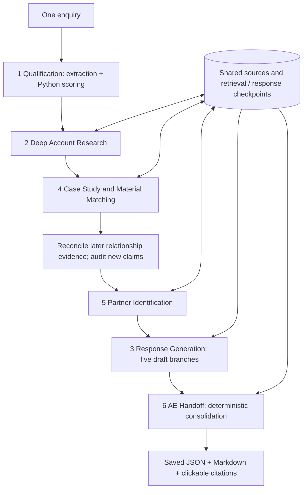

# Architecture and repair boundaries

The existing five-page Streamlit app and theme are retained. `workflow.py` is the same engine used by `app.py` and the CLI. There is no agent framework, database or outbound email service.

## Providers and safeguards

`run_allowance.py` adds a source-bound, append-only approval path for one cache-only continuation. It separates historical cumulative accounting from local UTC-day counts, operator-attested provider quota, new-run caps and protected reserves. Planning never authorizes expenditure. A second launch approval is mandatory; the new profile prohibits Tavily entirely, disables retries, forks history and clears only inherited model-response caches. New-run usage counts only new calls. Early failures save a failed new record. See `APPROVED_CONTINUATION.md` and `REVIEWER_GUIDE.md` for current instructions.

- `providers/groq.py`: strict Chat Completions JSON schema, Pydantic validation, low GPT OSS reasoning effort, completion floors and total request-size guard. Groq inference is independent of Tavily retrieval.
- `providers/tavily.py`: bounded basic Search/Extract; dynamic queries come from `evidence.derive_queries`.
- `provider.py`: sanitised HTTP errors, timeouts, bounded retry-after/pacing; schema errors are not blindly retried.
- `execution.py`, `budget.py`: explicit approval before dispatch/reservation, separate repair/demo envelopes, emergency protection and durable usage. Unknown usage is not refunded without actual provider data.

`MaterialChoice` contains four short fields. Full candidate records come from inspected evidence in Python and receive a separate audit. This avoids the recorded truncation of two deeply nested cases, each with six fully cited dimensions. AI preference is advisory; the evidence-gated local rubric selects the winner. Failed comparison/audit remains provisional.

## Evidence lifecycle

`Source` stores stable ID, URL, title, retrieval timestamp, publication metadata, text, search context and reading method. Ranking/deduplication never promotes snippets to inspected evidence. HTML/PDF readers preserve bounded relevant passages and identify partial-document reading.

`Claim` separates public/supplied/inference/unknown provenance. `grounding.py` checks IDs, exact passages, supplied approval/authority, financial units/currency/period/scope, dates and high-risk conclusions. `compact.audit_batches` deduplicates quotes and partitions requests without changing paths. Semantic audit findings are advisory, not a guarantee of truth.

`cross_stage.py` supersedes broad relationship denials when a later inspected own-company case is discovered. Original denials remain in the new run's audit log; narrower current-contract/site unknowns remain. New claim paths are pending until a real delta audit occurs. Older whole-stage labels cannot confer provenance; legacy deterministic-only markers also require review. Failed delta audits withhold new claims while preserving older cleared findings.

`selection.py` gates case dimensions and named partner ecosystem/capability/country assertions. Domicile, prior country activity, territory, proposed-site applicability and current availability are distinct. Direct AE ownership is valid when partner evidence is insufficient.

`sales_validation.py` withholds rejected paragraphs/subjects and retains originals for review. Atomic draft paragraphs separate buyer needs from public deployment facts and proposed questions. Only the initial branch addresses an actual enquiry; all follow-up situations are hypothetical. Nothing is sent.

`review.py` admits only individually supported/audited public findings downstream. Handoff includes original qualification identity, up to three distinct cleared findings, routing, questions and limitations. `identity.py` recovers missing legacy display fields from embedded qualification without editing the saved record or claiming public verification.

## State and honest completion

Each run saves ID, timestamps, input, configuration, six stages, sources, usage and logs. Resume forks the original, reuses exact successful response fingerprints and cached retrieval, and refreshes dependent drafts/handoff. Replay only loads files. Streamlit session state prevents navigation/downloads from initiating provider work.

Stage status, technical status and evidence status are separate. An unknown manager is a discovery gap, not a network failure. Missing required findings, unsupported claims, provider failures and unavailable audits cannot become successful acceptance merely by producing text.

The latest actual run remains partial. Offline fixtures verify software handling; current provider access, public-source entailment and a complete real execution still require separately approved live verification.
